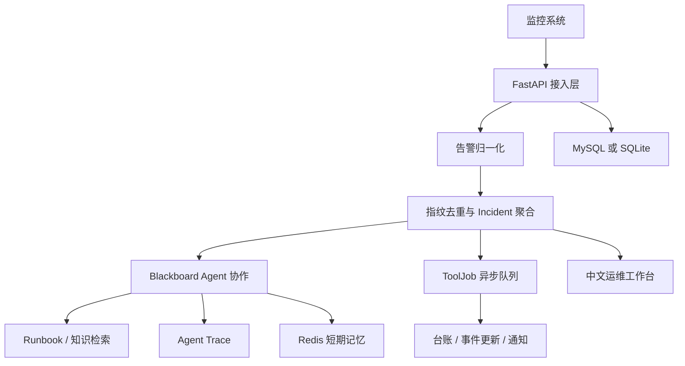

# OpsPilot

OpsPilot 是一个面向 SRE 和运维团队的智能告警研判与处置平台。它接收 Webhook 或 Prometheus Alertmanager 告警，将异构告警统一为标准事件，完成告警去重、Incident 聚合、知识检索、处置记录、异步通知和审计留痕。

平台关注告警触发后的处理过程：值班人员可以在同一工作台查看告警上下文、关联事件、Runbook、Agent 轨迹、工具任务和处置记录，并据此完成确认、跟进和关闭。

## 核心链路

```text
Webhook / Prometheus Alertmanager
        ↓
告警字段校验与归一化
        ↓
P0-P3 优先级、告警类型、状态统一
        ↓
稳定指纹去重与 Incident 聚合
        ↓
Agent 研判、Runbook 检索和证据组织
        ↓
异步台账、事件更新和通知任务
        ↓
值班人员确认、备注、关闭与审计
```

## 功能

### 告警接入与事件治理

- 支持通用 Webhook 和 Prometheus Alertmanager 接入。
- 将外部优先级统一为 P0、P1、P2、P3。
- 将告警类型统一为 `PROBLEM`、`BUSINESS`、`EVENT`、`HOST`。
- 统一 `firing`、`resolved` 等外部状态。
- 基于服务、环境、类型和稳定标签生成告警指纹。
- 将同一故障产生的多条告警聚合为 Incident。
- 保存来源、标签、注解、时间窗口和原始请求，便于追溯。

### 告警处置

- 支持确认接手、添加备注和关闭 Incident。
- P0/P1 告警进入通知链路，P2/P3 告警保留跟踪和审计记录。
- 记录负责人、确认时间、关闭时间和处理说明。
- 工作台支持告警筛选、事件详情、证据查看、协作记录和原始数据查看。

### Agent 协作

OpsPilot 使用事件驱动的 Blackboard 组织 Agent 协作状态，围绕上下文准备、候选研判和安全审查生成可检查的中间产物。

- 任务、产物、消息和事件使用结构化对象表示。
- 协调器按照优先级、能力和运行预算认领任务。
- 候选结果必须经过安全审查和置信度门槛才能采纳。
- 支持 Mock、Ollama 和 OpenAI-compatible 模型配置。
- 运行轨迹保存 Agent 步骤、产物和最终状态。

### 知识库与检索

- 支持 Markdown、文本和 PDF 知识导入。
- 对 Runbook、SOP 和服务说明进行切片并保存来源信息。
- 默认使用 BM25 和规则重排进行本地检索。
- 可选接入 Chroma 向量库，构建向量与关键词混合检索。
- 向量服务不可用时自动回退到 BM25，保留可用的排障路径。

### 异步工具队列

后台工具队列负责执行台账写入、Incident 更新和通知任务。

- 任务状态包括 `PENDING`、`RUNNING`、`SUCCESS` 和失败状态。
- 支持延迟重试、限流、启动恢复和死信记录。
- 记录尝试次数、下次执行时间和最后错误。
- 通知结果保存渠道、接收方和执行信息。
- 默认使用日志通知，避免本地演示误发真实邮件。

### MCP 工具服务

项目提供 MCP 工具服务入口，可扩展接入指标、日志、调用链、发布变更、代码检索、台账和通知工具。工具接入应通过白名单、参数校验、权限检查和审计记录控制，高风险写操作应保留人工审批。

## 系统架构



## 数据模型

| 对象 | 用途 |
|---|---|
| `AlertEvent` | 保存一条原始告警及其归一化结果 |
| `Incident` | 聚合多条相关告警，作为值班人员跟进的事件 |
| `AgentRunTrace` | 保存 Agent 处理步骤和研判轨迹 |
| `ToolJob` | 保存异步工具任务、重试和执行状态 |
| `NotificationRecord` | 保存通知渠道和发送结果 |
| `LedgerRecord` | 保存告警台账和处置留痕 |
| `KnowledgeChunk` | 保存 Runbook、SOP 和服务知识切片 |
| `DeadLetter` | 保存多次失败后需要人工处理的任务 |

## 本地运行

### 环境要求

- Python 3.11 或更高版本；
- Windows、Linux 或 macOS；
- Docker Compose（可选，用于 MySQL、Redis 和应用联调）。

### Windows 快速启动

```powershell
python -m venv .venv
.\.venv\Scripts\Activate.ps1
pip install -r requirements.txt
Copy-Item .env.example .env
powershell -ExecutionPolicy Bypass -File .\scripts\start-windows.ps1
```

浏览器访问 `http://127.0.0.1:8095`。本地演示账号为 `admin/admin123`。本地演示可以使用 SQLite、Mock 模型和日志通知：

```env
AI_PROVIDER=mock
DATABASE_URL=sqlite:///./target-local.sqlite
KNOWLEDGE_VECTOR_ENABLED=false
ALERT_EMAIL_DELIVERY_MODE=log
```

### Docker Compose

```bash
docker compose up -d --build
```

默认端口为 Web/API `8080`、MySQL `13306`、Redis `16379`。

## 模型配置

### Mock 模式

```env
AI_PROVIDER=mock
```

Mock 模式不调用外部模型，适合离线测试和页面演示。

### OpenAI-compatible API

```env
AI_PROVIDER=openai
OPENAI_BASE_URL=https://api.deepseek.com
OPENAI_API_KEY=your-api-key
OPENAI_MODEL=deepseek-chat
```

也可以接入其他兼容 Chat Completions 格式的模型服务。密钥只保存在本地 `.env`，不要提交到版本库。

### Ollama

```env
AI_PROVIDER=ollama
OLLAMA_BASE_URL=http://localhost:11434
OLLAMA_MODEL=your-model
```

## API 示例

健康检查：

```bash
curl http://127.0.0.1:8095/actuator/health
```

接入一条 Webhook 告警：

```bash
curl -X POST http://127.0.0.1:8095/api/alerts/webhook \
  -H "Content-Type: application/json" \
  -d '{
    "source": "manual",
    "externalId": "demo-payment-001",
    "title": "支付服务错误率升高",
    "description": "支付接口错误率超过 20%，持续 5 分钟。",
    "severity": "P1",
    "alertType": "problem",
    "status": "firing",
    "labels": {"service": "payment-service", "env": "staging", "instance": "payment-01"},
    "annotations": {"endpoint": "POST /v1/payments"}
  }'
```

Prometheus Alertmanager 使用 `POST /api/alerts/prometheus`。后台接口需要 Basic Auth：

```bash
curl -u admin:admin123 http://127.0.0.1:8095/api/admin/incidents
```

## 测试与回放

运行测试：

```powershell
$env:AI_PROVIDER="mock"
$env:PYTHONUTF8="1"
python -m pytest -q
```

当前本地回归结果为 `224 passed, 3 skipped`。测试覆盖优先级和类型归一化、指纹聚合、Webhook/Prometheus 转换、队列重试与死信、通知幂等、Blackboard 安全审查、Redis 记忆隔离、Runbook 检索指标、Skill 校验和回放数据契约。

回放数据位于 `app/static/fixtures/alert-replay-v1.json`，用于验证正常取证、工具超时、证据冲突、权限拒绝和人工审批流程。回放数据是合成演练数据，不代表真实生产事故或人工标注的根因准确率。

## 当前能力边界

当前版本适合本地演示、接口联调和工程回归。默认配置下模型可以使用 Mock，通知默认写日志，SQLite 可用于单机演示，Redis 短期记忆需要单独启动 Redis，Chroma 未启用时使用 BM25 回退。日志、指标、调用链和代码查询需要根据实际系统接入工具，高风险处置动作需要人工审批。

生产部署前应替换默认账号，启用正式身份认证、HTTPS、数据库备份、密钥管理、租户隔离和最小权限策略。建议先在隔离环境接入 Prometheus Alertmanager，以影子模式生成报告，再逐步接入真实指标、日志和知识库，最后进行小范围灰度。

## 目录结构

```text
app/api/          FastAPI 路由
app/agents/       Blackboard Agent 协作
app/core/         配置、安全和数据库初始化
app/models/       SQLAlchemy 数据模型
app/services/     告警、知识、记忆、队列和通知服务
app/mcp_tools/    MCP 工具服务
app/rag_eval/     知识检索评测
app/static/       中文运维工作台和回放数据
app/knowledge/    示例 Runbook
scripts/          启动、联调和打包脚本
tests/            自动化测试
```

## License

请遵循仓库中的许可证和第三方依赖许可证。
